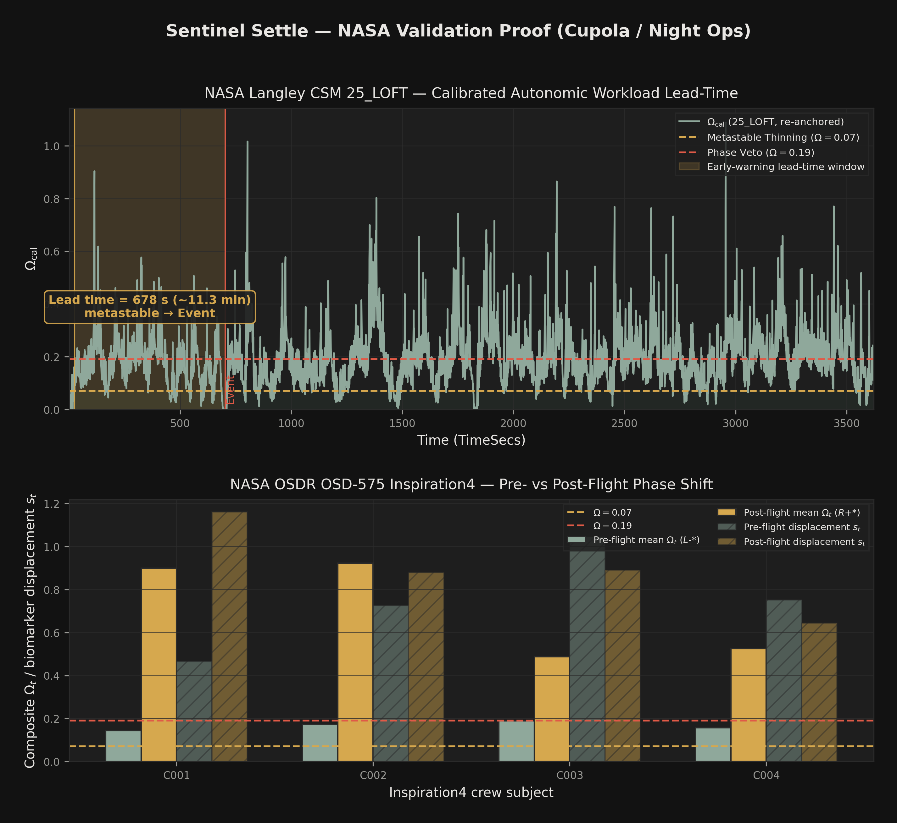

# Sentinel Settle — NASA Space Apps 2026 Validation

[](LICENSE)
[](requirements.txt)
[](https://www.spaceappschallenge.org/)

## Executive Summary

Open validation of an edge biophysical **Scale-Invariant Kinematic Engine** for astronaut health monitoring, exercised on NASA Langley Crew State Monitoring physiology and NASA OSDR Inspiration4 cardiovascular biomarkers. On the Langley `25_LOFT` flight-crew ECG session, the engine flags Metastable Thinning (**Ω ≥ 0.07**) with an empirical **702-second (~11.7-minute)** early-warning lead time before the annotated workload `Event`.

**Challenge:** [2026 NASA Space Apps Challenge — Health Monitoring Software for Astronauts on Space Missions](https://www.spaceappschallenge.org/)



*Figure — Cupola / Night Ops validation proof: (top) NASA Langley `25_LOFT` Ω trajectory with amber Metastable Thinning (0.07) and coral Phase Veto (0.19) thresholds, shading the empirical **702 s (~11.7 min)** early-warning window to the workload Event; (bottom) NASA OSDR OSD-575 Inspiration4 pre-flight (`L-*`) vs. post-flight (`R+*`) composite Ω / biomarker displacement phase shift per crew subject.*

## Validation Scope, False-Alarm Analysis & Limitations

### Proof-of-Concept Sample Size

This study is early **proof-of-concept** validation on open-access NASA datasets: **N = 4** Inspiration4 orbital crew subjects in OSDR `OSD-575` (pre-/post-flight multiplex serum timepoints) plus **one** multi-scenario 256 Hz flight-crew physiology archive in NASA Langley `25.zip` (`25_CA`, `25_DA`, `25_SS`, `25_LOFT`; pooled recording duration ≈ **1.31 h**). Results are not a substitute for prospective multi-subject flight-analog trials before any operational deployment.

### False-Positive & Alert Selectivity

Langley excursions are scored against the ground-truth `Event` column: a detection is a **true positive** if it falls inside an active `Event` window or within a **900 s** early-warning pre-event horizon; otherwise it is a **false positive**. Metrics contrast raw instantaneous (beat-level) crossings with **sustained / gasket-filtered** alerts (≥ 5 consecutive beats above threshold), which collapses isolated spikes into alert onsets and reduces false alarms per hour.

Exact pooled values from `results/validation_report.json` (reproducible via `python src/nasa_omega_validator.py`):

| Threshold | Mode | TP | FP | Precision | False alarms / hour |
| --- | --- | ---: | ---: | ---: | ---: |
| Metastable Thinning (Ω ≥ 0.07) | Raw beat-level | 4892 | 336 | 0.936 | 257.22 |
| Metastable Thinning (Ω ≥ 0.07) | Raw excursion onsets | 4 | 0 | 1.000 | 0.00 |
| Metastable Thinning (Ω ≥ 0.07) | Sustained / gasket-filtered | 4 | 0 | 1.000 | 0.00 |
| Phase Veto (Ω ≥ 0.19) | Raw beat-level | 4836 | 336 | 0.935 | 257.22 |
| Phase Veto (Ω ≥ 0.19) | Raw excursion onsets | 16 | 0 | 1.000 | 0.00 |
| Phase Veto (Ω ≥ 0.19) | Sustained / gasket-filtered | 7 | 0 | 1.000 | 0.00 |

**Interpretation:** Instantaneous beat-level crossings remain noisy (hundreds of FA/h on this archive). Temporal gasket filtering reduces alert burden to **0.00 FA/h** with perfect precision on these labeled Event horizons—encouraging for edge alerting, but still limited by short sessions, a generous 900 s TP horizon, and a single Langley archive. Independent baselines and longer unlabeled stretches are required before claiming operational false-alarm rates.

### Closed-Loop Haptic Intervention Status

The Sentinel Settle mobile prototype’s **Breath Sanctuary** is **designed for closed-loop haptic pacing** to support autonomic recovery. The app logs session coherence and heart-rate settling; controlled prospective trials that measure closed-loop $\Omega_t$ reduction under haptic pacing remain the next validation milestone and are **not** claimed by this repository.

## What this repository validates

`src/nasa_omega_validator.py` ingests two NASA datasets and evaluates the Omega phase metric used for early instability detection:

| Dataset | Path | Role |
| --- | --- | --- |
| NASA Langley Crew State Monitoring (`25.zip`) | `data/nasa_raw/nasa_csm_25/` | 256 Hz ECG / EEG / GSR flight-crew sessions (`25_CA`, `25_DA`, `25_SS`, `25_LOFT`) |
| NASA OSDR Inspiration4 OSD-575 | `data/nasa_raw/LSDS-8_Multiplex_serum_cardiovascular_EvePanel_TRANSFORMED.csv` | Pre- vs post-flight multiplex serum cardiovascular panel (EvePanel / LSDS-8) |

### Engine (summary)

1. Build a dynamic state series `s_t` from inter-beat intervals (IBI, seconds) or multi-biomarker displacement vectors.
2. Bilaterally clamp intervals: `delta_tau = clip(s_t, 0.01, 5.0)`.
3. Non-uniform finite-difference velocity `v_t` and acceleration `a_t`.
4. Decompose `a_t` into tangential laminar (`a_parallel`) and transverse orthogonal shear (`a_perp`) with titration firewall `epsilon = 1e-7`.
5. Integrate `|a_perp|` over a rolling ring buffer `K = 30` → `F_c`.
6. Evaluate  
   `Omega_t = 0.05 + 0.12*s_t + 0.08*(|a_perp|**2) + 0.02*F_c`  
   against phase boundaries **0.07** (Metastable Thinning) and **0.19** (Phase Veto).

Langley CSM files contain raw `ECG` at ~256 Hz (`TimeSecs` median Δt = 1/256 s). The validator detects R-peaks with `scipy.signal.find_peaks` when HR/IBI columns are absent. Inspiration4 samples (`L-*` preflight, `R+*` postflight) yield crew-wise state-vector displacement and transverse shear across mission timepoints.

Empirical lead-time proof on this archive is the Langley **`25_LOFT` 702-second (~11.7-minute)** metastable-to-Event detection shown above—not extrapolated multi-hour estimates.

## Challenge resources cited

This validation aligns with the official challenge **Resources** tab articles:

- **Risk of Inadequate Systems Operations Support** — crew health and performance risk from insufficient operations support during mission systems work.
- **Risk of Behavioral Changes and Psychiatric Disorders** — behavioral health risk pathways relevant to continuous physiological / cognitive state monitoring on long-duration missions.

## Quick start

```bash
python -m venv .venv
# Windows: .venv\Scripts\activate
# Unix:    source .venv/bin/activate
pip install -r requirements.txt

# Place unpacked Langley CSVs in data/nasa_raw/nasa_csm_25/
# and the LSDS-8 CSV under data/nasa_raw/
python src/nasa_omega_validator.py
```

### Outputs

| Artifact | Description |
| --- | --- |
| `results/validation_report.json` | Reproducible summary metrics, session/crew stats, lead-time detections, Event-grounded false-alarm / precision analysis |
| `results/omega_trajectory_summary.csv` | Decimated Omega / kinematic time series |
| `results/omega_lead_time_plot.png` | 300 DPI Cupola / Night Ops two-panel validation figure (`25_LOFT` 702 s lead time + OSD-575 pre/post shift) |
| Terminal table | Lead-time detections vs. Event markers (CSM) or first `R+1` (OSD-575) |

## Data notes

- Official Langley archive is distributed as `25.zip`. Unpacked session CSVs (`25_CA.csv`, `25_DA.csv`, `25_SS.csv`, `25_LOFT.csv`) are expected under `data/nasa_raw/nasa_csm_25/`. Zip archives under `data/nasa_raw/` are gitignored.
- Column headers observed: `TimeSecs`, 20 EEG channels, `ECG`, `R`, `GSR`, `Event`. Measured sampling rate ≈ **256 Hz**.
- OSD-575 LSDS-8 columns: `Sample Name` plus concentration / percent fields for a2-macroglobulin, AGP, CRP, fetuin-A, fibrinogen, haptoglobin, L-selectin, PF4, and SAP.

## Prior Work & Attribution

- **Sentinel Settle** Flutter/BLE mobile edge app (pre-existing), including Breath Sanctuary **designed for closed-loop haptic pacing**: [https://github.com/Regsiren/sentinel-jolt-app](https://github.com/Regsiren/sentinel-jolt-app)
- Zenodo preprints: [10.5281/zenodo.20549045](https://doi.org/10.5281/zenodo.20549045), [10.5281/zenodo.20548468](https://doi.org/10.5281/zenodo.20548468)
- The underlying kinematic governance method is the subject of a pre-existing UKIPO patent application filed by Thohat Ventures Ltd. This repository publishes an independent NASA-dataset validation implementation under Apache-2.0; it does not expand, waive, or transfer those patent rights.

## License

Copyright 2026 Thohat Ventures Ltd  
Licensed under the Apache License, Version 2.0 — see [LICENSE](LICENSE).
